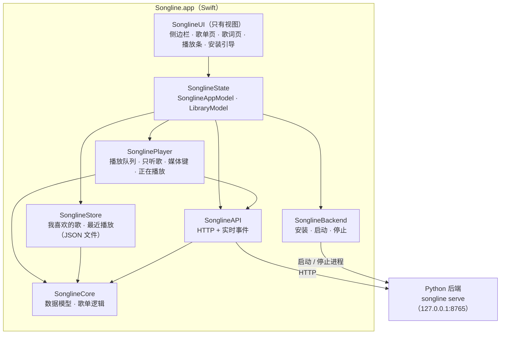

# Songline for Mac：架构设计

> 状态：第 1、2 步的系统接口和第 3 步的打包发布已实现（分支 `mac-app`），界面由 Codex 按 [AGENTS.md](AGENTS.md) 制作。还没做：Sparkle 自动更新、签名和公证。

目标：做一个原生的 Mac 音乐播放器，把直播回放当歌单来听。
双击打开，不需要终端；朋友们**用 Xcode 打开就能改代码、点 Run 运行**。

布局沿用音乐播放器常见的结构：左侧栏、歌单页、底部播放条、歌词页。
视觉风格由我们自己设计，不照搬任何现有产品的配色、图标或品牌元素。

## 1. 产品形态

Songline 的数据天然就是音乐播放器的数据：

| 播放器里的概念 | Songline 里对应的东西 |
|---|---|
| 歌单 | 一场直播回放（封面 = 视频封面，创建者 = UP 主） |
| 歌曲 | 回放里识别出的一首歌（歌名、原唱、开始和结束时间） |
| 歌词 | 那一段的语音转写，每句都带时间，可以逐句高亮滚动 |
| 播放 | 在回放音频里，从这首歌的开始播到结束 |

**主要界面：**

```
┌──────────────┬─────────────────────────────────────────┐
│ 侧边栏        │  歌单页：大封面 · 标题 · UP 主 · 23 首       │
│  ＋ 识别新回放 │  [▶ 播放全部] [只听歌 ⇄] [复制时间轴]        │
│  搜索         │  ─────────────────────────────────────── │
│  我喜欢的歌    │   1  风月吻眉梢      礼越     00:01  3:20  │
│  ──────────  │   2  爱的华尔兹      俞灏明   00:08  4:05  │
│  回放歌单      │   …                                       │
│   11-19 晚上  │                                           │
│   11-13      │                                           │
├──────────────┴─────────────────────────────────────────┤
│ [封面] 爱的华尔兹 · 俞灏明  ⏮ ⏯ ⏭  ━━━●━━━━ 03:12/04:05 🔀 │  ← 底部播放条
└────────────────────────────────────────────────────────┘
```

- **歌词页**：点底部播放条上的封面进入。左边是大封面，右边是转写出的歌词，跟着播放进度逐句高亮滚动；点某一句就跳到那里播放。
- **「只听歌」模式（Songline 独有）**：按歌单连续播放时自动跳过歌与歌之间的聊天，把两小时的直播变成一张纯音乐专辑。关掉就按原样播放整场回放。
- **识别进度**：新回放识别期间，在侧边栏里显示进度，识别出的歌会陆续出现在歌单里。
- **我喜欢的歌**：可以收藏任意一场里的任意一首，跨直播组成自己的歌单。
- **系统集成**：媒体键、控制中心和锁屏的「正在播放」、菜单栏迷你播放器、把 B 站链接拖到 Dock 图标上就开始识别。

## 2. 总体结构

识别能力（Python 后端）原样复用；界面全部用 SwiftUI 重写。原来的网页界面继续保留，给浏览器和一键安装版的用户用，App 不依赖它。



## 3. 工程结构

```
mac/
  Songline.xcodeproj          ← 朋友们打开这个
  Songline/                   ← App 本体（很薄，只负责组装）
    SonglineApp.swift         @main：主窗口、菜单命令；退出时关闭后端
    Assets.xcassets           App 图标、主色
  Config/Info.plist           允许访问本机 http（识别服务）
  Packages/SonglineKit/       ← 本地 Swift Package，正经代码都在这里
    Package.swift
    Sources/
      SonglineCore/
      SonglineAPI/
      SonglineBackend/
      SonglinePlayer/
      SonglineStore/
      SonglineState/          App 级状态，不含视图
        SonglineAppModel.swift  把各模块串起来的总状态
        LibraryModel.swift      歌单列表、侧边栏选中项、实时进度
      SonglineUI/             只有 SwiftUI 视图
        Sidebar/  Playlist/  NowPlaying/  PlayerBar/
        Recognize/  Favorites/  Onboarding/  MiniPlayer/
        DesignSystem/         颜色、字体、间距、通用组件
    Tests/                    每个模块各一个测试目录
  scripts/bundle-backend.sh   构建时把后端代码和 uv 打进 App
  ARCHITECTURE.md             本文件
```

**为什么这样分：**

- **App 本体很薄，代码都在 Swift Package 里。** 模块之间的依赖关系写在 `Package.swift` 里，一眼能看清。每个模块可以单独编译、单独测试（`swift test`），CI 不用打包整个 App。
- **界面按功能分文件夹**：一个功能一个文件夹，朋友们分工时各改各的，不容易冲突。
- **`DesignSystem/` 集中放配色、字体和通用组件**（封面图、歌曲行、播放按钮）。整个 App 的外观统一从这里调整。
- **`.xcodeproj` 使用「文件夹同步」**（Xcode 16 起支持）：新建文件会自动加入工程，`project.pbxproj` 几乎不变，多人开发不容易冲突。
- **不用 XcodeGen、Tuist 这类工具**，装好 Xcode 就能开工。

## 4. 模块职责

依赖只能自上而下：`UI → State → Player / Store / API / Backend → Core`。

**界面和系统的分界线就在 `SonglineUI` 和 `SonglineState` 之间。** `SonglineUI` 只放视图，读写 `SonglineState` 提供的状态和操作；其余模块是系统层。这样界面可以交给别人（或 AI 助手）整个重做，不会碰到业务逻辑。界面开发的约定见 [AGENTS.md](AGENTS.md)。

| 模块 | 负责 | 关键类型 | 依赖 |
|---|---|---|---|
| **SonglineCore** | 与后端 JSON 一一对应的模型；歌单上的纯逻辑：当前是哪首、上一首/下一首、只听歌模式下下一段从哪播、歌词按时间定位 | `Job` `TimelineEntry` `SongRef` `VideoInfo` `Segment` `Stage`；`Timeline` `LyricsIndex` | 无 |
| **SonglineAPI** | 调用后端接口；用 `URLSession` 逐行读取实时事件（SSE），转成 `AsyncThrowingStream<Job>` | `protocol SonglineService`、`HTTPSonglineService`、`MockSonglineService` | Core |
| **SonglineBackend** | 首次安装（uv、依赖、语音模型，带进度）；启动 `songline serve` 并等它就绪；崩溃后自动重启；App 退出时关闭；保留日志 | `@MainActor @Observable BackendRuntime`（耗时操作都在子进程里）、`enum BackendState` | 无 |
| **SonglinePlayer** | `AVPlayer` 播放回放音频；播放队列（可以跨多场直播）；只听歌模式；接入媒体键（`MPRemoteCommandCenter`）和正在播放（`MPNowPlayingInfoCenter`） | `@MainActor @Observable PlayerModel`、`QueueItem` | Core、API |
| **SonglineStore** | 本地数据：我喜欢的歌、最近播放。存在本机一个 JSON 文件里 | `LibraryStore`、`SavedSong` | Core |
| **SonglineState** | App 级状态：启动后端、就绪后连上接口、管理歌单列表和侧边栏选中项、跟踪识别进度。不含任何视图，可以单独测试 | `SonglineAppModel`、`LibraryModel` | Core、API、Backend、Player、Store |
| **SonglineUI** | 只有视图；读写 `SonglineState` 和播放器的状态，自己不发网络请求、不碰进程和音频 | `RootView` `PlaylistView` `NowPlayingView` `PlayerBar` … | State（及其下各层的数据类型） |

`BackendState` 决定 App 当前显示什么：

```
notInstalled → installing(步骤, 进度) → starting → running(baseURL)
                                  ↘ failed(原因, 日志) ↙   （可重试）
```

## 5. 关键设计决定

**5.1 后端：代码随 App 打包，依赖首次打开时安装**
- 构建时，`bundle-backend.sh` 把 `backend/`（不含 `.venv`）和 `uv` 程序（约 28 MB）复制进 `Songline.app/Contents/Resources/`。App 和后端版本永远一致。
- 首次打开时，用打包进来的 `uv` 在 `~/Library/Application Support/Songline/venv` 装好 Python 3.12 和依赖，再下载语音模型（约 1.6 GB），引导页显示进度。这部分不打进 App，安装包只有几十 MB。
- 用 `uv.lock` 的哈希判断依赖有没有变化。App 更新后依赖没变，就不用重装。
- 识别记录仍然放在 `~/.songline`，和命令行版、一键安装版共用，原来的历史记录都还在。

**5.2 后端进程：子进程，固定端口 8765**
- 用 `Process` 启动 `songline serve --no-open --port 8765`，轮询 `/api/jobs`，返回正常就算就绪。
- 如果 8765 已经被一个正在运行的 Songline 占用，就直接连那个，不再启动第二个。浏览器里的「发送到 Songline」书签也因此继续有效。
- App 退出时先发 SIGTERM，等 3 秒还没退出就强制结束。后端意外退出时自动重启，最多 3 次，之后在界面上显示错误和日志。

**5.3 播放：一首歌 = 回放音频里的一段**
- 队列里的每一项是 `(回放 id, 开始时间, 结束时间)`。播到结束时间就切到下一项，所以只听歌模式只是"下一项从哪开始"的规则不同。
- 这些规则写在 `SonglineCore` 里，不依赖播放器，可以直接写单元测试。
- 音频直接用后端的 `/api/jobs/{id}/audio`，它支持按范围读取（HTTP Range），`AVPlayer` 跳转不用先下载完整文件。

**5.4 歌词：用转写内容**
- 来自 `/api/jobs/{id}/transcript`，每句都有开始和结束时间，正好可以逐句滚动。
- 只显示当前这首歌时间范围内的句子；「只听歌」关闭时显示整场的转写。

**5.5 我喜欢的歌：存在本机（JSON 文件）**
- 收藏时记下 `bvid + 第几 P + 开始时间 + 歌名`，不依赖后端的任务 id。删除并重新识别同一场回放后，收藏依然能对上（开始时间允许 30 秒内的出入）。
- 存在 `~/Library/Application Support/Songline/library.json`。原计划用 SwiftData，实际改用 JSON：数据量小，不用处理数据库迁移，出问题可以直接打开文件看，测试也简单。
- 不改后端，网页版不受影响。

**5.8 外部链接**
- `songline://open?url=<B 站链接>`：App 已注册这个链接格式，浏览器书签或其他 App 可以直接把视频交给 Songline。
- 拖进窗口的链接、粘贴的分享文字都走 `SonglineAppModel.open(link:)`：识别过的视频直接打开结果，没识别过的才开始识别；后端还没就绪时先记下，就绪后再打开。

**5.6 并发**
- 使用 Swift 6 严格并发检查。界面要观察的状态类（`BackendRuntime`、`LibraryModel`、`PlayerModel`）都是 `@MainActor @Observable`，耗时工作放在子进程或 `async` 网络请求里，不会卡住界面；跨模块传递的数据都符合 `Sendable`。

**5.7 沙盒、签名与系统版本**
- 关闭 App Sandbox：需要启动子进程，还要读写 `~/.songline` 和 Application Support。开启 Hardened Runtime，为以后公证做准备。
- 没有付费开发者账号时，朋友第一次打开需要在「系统设置 → 隐私与安全性」里点「仍要打开」。
- 最低 macOS 14：需要 `@Observable` 和 `MenuBarExtra`。MLX 本来就只支持 Apple Silicon，用户的系统都不会太旧。

## 6. 依赖（Swift Package Manager）

**第 1、2 步不用任何第三方库**，全部是系统框架：

| 需求 | 用什么 |
|---|---|
| 界面、窗口、菜单栏 | SwiftUI、AppKit |
| 网络请求、实时事件（SSE） | `URLSession`（`bytes(for:)` 逐行读取） |
| 封面图片 | `AsyncImage` + `URLCache` |
| 播放音频 | AVFoundation（`AVPlayer`） |
| 媒体键、正在播放 | MediaPlayer |
| 本地收藏、播放记录 | `Codable` + JSON 文件 |
| 运行后端进程 | Foundation（`Process`） |
| 日志 | `os.Logger` |
| 测试 | Swift Testing（Xcode 自带） |

**第 3 步（发给朋友）再加：**

| 库 | 用途 |
|---|---|
| [Sparkle](https://github.com/sparkle-project/Sparkle) | 自动检查更新、一键升级。Mac 上非 App Store 应用的事实标准 |

**可选，以后有需要再加：**

| 库 | 用途 |
|---|---|
| [KeyboardShortcuts](https://github.com/sindresorhus/KeyboardShortcuts) | 让用户自定义全局快捷键 |

原则：尽量少引入依赖。每多一个库，朋友们打开工程时就要多下载一份，出问题时也多一个排查点。

## 7. 朋友们怎么开发

1. 打开 `mac/Songline.xcodeproj`，选 `Songline` scheme，点 Run。
2. **只改界面、不想跑后端**：每个界面都提供 `#Preview`，使用 `MockSonglineService`。它自带两场假的直播回放和歌词，不需要 Python。
3. **新功能放在哪：**
   - 新界面 → `SonglineUI/功能名/`；通用组件放 `DesignSystem/`。
   - 新接口 → 先在 `SonglineService` 协议里加方法，再在 `HTTPSonglineService` 和 `MockSonglineService` 里各实现一次。
   - 纯逻辑（切歌、歌词定位）→ 放 `SonglineCore`，配上测试。
4. 提交前运行 `swift test --package-path mac/Packages/SonglineKit`。CI 也会跑这个，同时用 `xcodebuild` 编译整个 App。

## 8. 实施步骤

1. **能听的 App**：工程骨架；Core、API、Backend 模块；首次安装引导；侧边栏 + 歌单页 + 底部播放条；识别新回放（含进度）；按歌播放和切歌。
2. **像播放器**：歌词页、只听歌模式、播放队列、媒体键和正在播放、菜单栏迷你播放器、拖链接到 Dock。
3. **我的音乐和发给朋友**：我喜欢的歌、最近播放、搜索；打包 `.dmg`、CI 自动出包（`scripts/package.sh`、`.github/workflows/release.yml`）。还没做：Sparkle 自动更新（需要生成更新签名密钥并存进 GitHub 的 Secrets），以及有开发者账号后的签名和公证。
